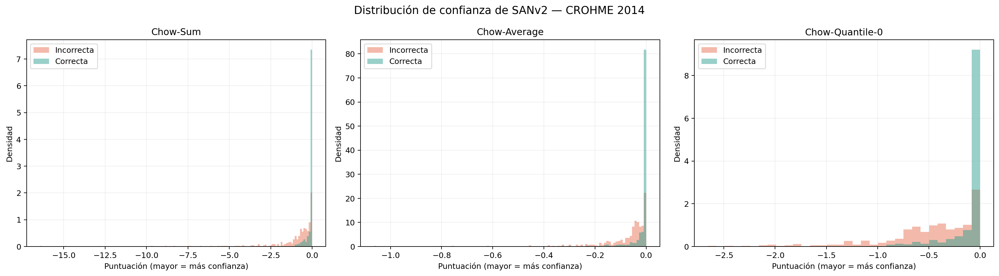
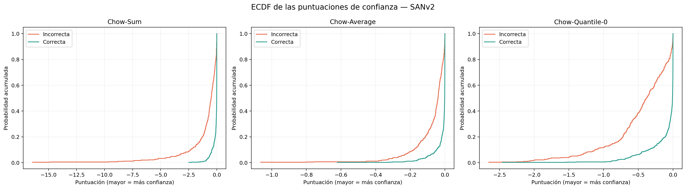
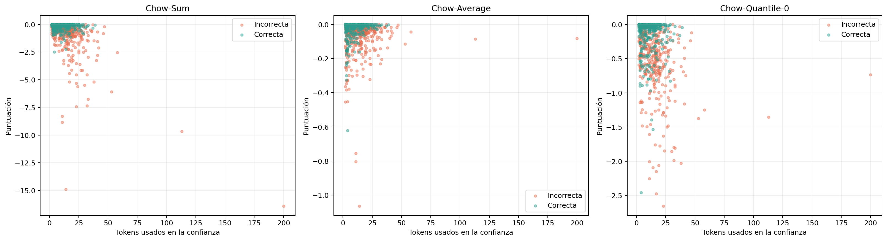

# Análisis de confianza de SANv2 en CROHME 2014

## Objetivo

Se evaluó si las probabilidades producidas por SANv2 permiten distinguir entre predicciones correctas e incorrectas en el conjunto de test CROHME 2014. Para cada expresión se tomó la probabilidad asignada por el modelo a cada token seleccionado durante la decodificación voraz y se calcularon tres medidas:

\[
s_{\mathrm{sum}}(x)=\sum_{i=1}^{n}\log p_i,
\]

\[
s_{\mathrm{avg}}(x)=\frac{1}{n}\sum_{i=1}^{n}\log p_i,
\]

\[
s_{\mathrm{min}}(x)=\min_{1\leq i\leq n}\log p_i.
\]

Estas medidas corresponden, respectivamente, a **Chow-Sum**, **Chow-Average** y **Chow-Quantile-0**. Como las probabilidades pertenecen al intervalo \((0,1]\), sus logaritmos son menores o iguales que cero; por tanto, en los tres casos una puntuación más cercana a cero representa mayor confianza.

## Protocolo experimental

- Se procesaron las 986 imágenes de CROHME 2014.
- No hubo imágenes faltantes ni errores de ejecución.
- Se utilizó el checkpoint preentrenado incluido en SANv2, con 7,996,103 parámetros.
- Las predicciones de SANv2 coincidieron con las 986 predicciones obtenidas previamente con SAN. La instrumentación de probabilidades no alteró la salida del modelo.
- La referencia canónica fue la anotación de Modelo2.
- La evaluación común normalizó espacios y eliminó exclusivamente el token `\limits`.
- Se excluyó `<eos>` del cálculo de confianza y se incluyó el token interno `struct`.
- Las probabilidades sigmoid de las relaciones estructurales se conservaron como información auxiliar, pero no se mezclaron con las medidas basadas en el softmax del vocabulario.

La ejecución se realizó con Python 3.8.10, PyTorch 2.0.1+cu118 y una GPU NVIDIA GeForce RTX 4050 Laptop GPU.

## Validación del reconocimiento

| Indicador | Resultado |
|---|---:|
| Muestras solicitadas | 986 |
| Muestras válidas | 986 |
| Errores de ejecución | 0 |
| Predicciones correctas | 560 |
| Predicciones incorrectas | 426 |
| Exact match común normalizado | 56.80 % |

El exact match reproduce el resultado obtenido en la comparación previa entre SAN y PosFormer. Esto confirma que el cálculo adicional de probabilidades no modificó la ruta de decodificación ni los pesos preentrenados.

## Resultados de los tres medidores

| Medidor | Grupo | Media | Mediana | Q25 | Q75 |
|---|---|---:|---:|---:|---:|
| Chow-Sum | Correctas | -0.117247 | -0.008765 | -0.083630 | -0.001000 |
| Chow-Sum | Incorrectas | -0.984166 | -0.503343 | -1.050881 | -0.150957 |
| Chow-Average | Correctas | -0.016660 | -0.001081 | -0.009076 | -0.000145 |
| Chow-Average | Incorrectas | -0.073468 | -0.039875 | -0.093085 | -0.015944 |
| Chow-Quantile-0 | Correctas | -0.099476 | -0.007050 | -0.072217 | -0.000609 |
| Chow-Quantile-0 | Incorrectas | -0.477312 | -0.381970 | -0.664747 | -0.112567 |

Los tres medidores asignaron, en promedio y en la mediana, mayor confianza a las expresiones reconocidas correctamente. La diferencia es especialmente visible en las medianas:

- En Chow-Sum, la mediana fue -0.008765 para los aciertos y -0.503343 para los errores.
- En Chow-Average, fue -0.001081 para los aciertos y -0.039875 para los errores.
- En Chow-Quantile-0, fue -0.007050 para los aciertos y -0.381970 para los errores.

Al regresar del dominio logarítmico, estas medianas tienen una interpretación intuitiva:

| Interpretación de la mediana | Correctas | Incorrectas |
|---|---:|---:|
| Producto de probabilidades de la secuencia, `exp(Chow-Sum)` | 0.991273 | 0.604506 |
| Media geométrica por token, `exp(Chow-Average)` | 0.998920 | 0.960909 |
| Probabilidad del token menos confiable, `exp(Chow-Quantile-0)` | 0.992974 | 0.682516 |

Estas transformaciones no cambian el orden de las muestras; solamente facilitan la lectura. En particular, la expresión incorrecta mediana contiene una decisión mínima considerablemente menos segura que la expresión correcta mediana.

Los histogramas muestran una concentración pronunciada de predicciones correctas cerca de cero. Las incorrectas se extienden hacia valores más negativos, aunque existe una zona de solapamiento cerca de cero. Por tanto, la confianza contiene información útil para el enrutamiento, pero ningún umbral puede separar perfectamente aciertos y errores.

## Distribución acumulada

Las curvas acumuladas confirman el desplazamiento de los errores hacia puntuaciones menores. Para un mismo valor de confianza, una proporción mayor de predicciones incorrectas ya se encuentra acumulada en la parte baja de la distribución. La separación es visible en los tres medidores y es consistente con sus medias y cuantiles.

Como resumen descriptivo adicional, se calculó el área bajo la curva ROC tomando una puntuación mayor como indicación de que la predicción es correcta:

| Medidor | AUROC descriptiva |
|---|---:|
| Chow-Sum | 0.8447 |
| Chow-Quantile-0 | 0.8322 |
| Chow-Average | 0.8250 |

Chow-Sum produjo la mayor separación ordinal en este conjunto. Esto significa que, al elegir al azar una predicción correcta y una incorrecta, Chow-Sum asigna una puntuación mayor a la correcta en aproximadamente 84.47 % de los pares. Este cálculo es descriptivo sobre el test y no debe interpretarse todavía como rendimiento validado de un *gate*.

## Efecto de la longitud

El número de tokens utilizados en el cálculo presentó las siguientes características:

| Grupo | Media | Mediana | Mínimo | Máximo |
|---|---:|---:|---:|---:|
| Todas | 11.84 | 10 | 2 | 200 |
| Correctas | 9.70 | 9 | 2 | 39 |
| Incorrectas | 14.64 | 13 | 2 | 200 |

Las predicciones incorrectas fueron, en general, más largas. Esto puede deberse tanto a la mayor dificultad de las expresiones largas como a errores de decodificación que generan secuencias excesivas.

La correlación de Spearman entre longitud y puntuación fue:

| Medidor | Correlación con la longitud |
|---|---:|
| Chow-Sum | -0.3900 |
| Chow-Average | -0.1266 |
| Chow-Quantile-0 | -0.3489 |

Chow-Sum presenta la dependencia esperada: cada token agrega un término no positivo, por lo que las secuencias largas tienden a obtener puntuaciones menores. Chow-Quantile-0 también depende de la longitud, pues una secuencia con más decisiones tiene más oportunidades de contener un token de baja confianza. Chow-Average fue el medidor menos relacionado con la longitud y, por ello, ofrece la comparación más estable entre expresiones de tamaños distintos.

Existe una muestra atípica, `RIT_2014_53`, con 200 tokens de confianza. SANv2 repitió el símbolo `|` hasta alcanzar el límite de decodificación, obtuvo Chow-Sum = -16.423439 y fue incorrecta. Este caso domina la cola izquierda de Chow-Sum y evidencia que esta medida también detecta ciertas decodificaciones degeneradas.

## Errores con confianza alta

El solapamiento entre distribuciones se explica en parte por predicciones incorrectas realizadas con gran seguridad. Algunos ejemplos son:

| ID | Predicción SANv2 | Referencia | Chow-Sum |
|---|---|---|---:|
| `29_em_157` | `y = y` | `y = y \prime` | -0.000008 |
| `RIT_2014_257` | `\frac { 1 } { 3 } \sqrt { 3 }` | `\frac { 1 1 } { 3 } \sqrt { 3 }` | -0.000018 |
| `512_em_282` | `\sqrt { x ^ { 2 } }` | `\sqrt [ 3 ] { x ^ { 2 } }` | -0.000053 |
| `37_em_25` | `\sqrt { b }` | `\sqrt [ x ] { b }` | -0.000070 |

En estos casos el modelo no expresa incertidumbre: asigna probabilidades muy altas a una secuencia incompleta o visualmente confundida. Este comportamiento muestra que la salida softmax no está necesariamente calibrada y que un *gate* basado solo en confianza dejará pasar algunos errores con mucha seguridad.

## Comparación de los medidores

### Chow-Sum

Fue el medidor con mayor AUROC descriptiva y separó con claridad las medianas de ambos grupos. También penaliza fuertemente las secuencias largas y las decodificaciones degeneradas. Su principal desventaja es que parte de su capacidad de separación puede provenir de la longitud, ya que las expresiones incorrectas fueron más largas en promedio.

### Chow-Average

Mostró la menor correlación con la longitud y es el medidor más directamente comparable entre expresiones de tamaño variable. Su separación ordinal fue ligeramente menor que la de las otras dos medidas, pero constituye una referencia importante para evitar que el *gate* confunda longitud con incertidumbre.

### Chow-Quantile-0

Ofreció un punto intermedio en capacidad discriminativa. Es interpretable como la confianza del token más débil y puede detectar una única decisión dudosa. Sin embargo, también se vuelve más severo cuando aumenta la longitud y puede ignorar la acumulación de varios errores moderados.

## Conclusiones

1. Las probabilidades extraídas de SANv2 contienen una señal útil: las predicciones correctas presentan valores claramente más cercanos a cero en los tres medidores.
2. Ningún medidor separa por completo los aciertos de los errores. Existen predicciones incorrectas con confianza prácticamente máxima.
3. Chow-Sum obtuvo la mayor capacidad de ordenamiento descriptiva, con AUROC 0.8447, pero está afectado por la longitud de la secuencia.
4. Chow-Average fue el medidor más estable respecto a la longitud y debe conservarse como candidato principal cuando se comparen expresiones de tamaño variable.
5. Chow-Quantile-0 aporta información sobre la decisión menos segura y mostró una separación ligeramente superior a Chow-Average, aunque con mayor efecto de longitud.
6. La selección de un medidor y de un umbral definitivo no debe realizarse directamente sobre este conjunto de test. Conviene ajustar o calibrar el *gate* con un conjunto de validación separado y reservar CROHME 2014 para la evaluación final.
7. Antes de implementar la cascada, resulta conveniente comparar curvas riesgo–cobertura o exactitud–cobertura de los tres medidores y evaluar cuántos errores de SAN puede recuperar el segundo modelo para cada porcentaje de muestras enrutadas.

## Archivos relacionados

- Notebook: [`distribucion_confianza_sanv2_crohme_2014.ipynb`](distribucion_confianza_sanv2_crohme_2014.ipynb)
- Resultados por expresión: [`resultados/confianza_sanv2_crohme_2014.csv`](resultados/confianza_sanv2_crohme_2014.csv)
- Cuantiles y estadísticos: [`resultados/distribucion_confianza_sanv2_crohme_2014.csv`](resultados/distribucion_confianza_sanv2_crohme_2014.csv)
- Resumen estructurado: [`resultados/resumen_confianza_sanv2_crohme_2014.json`](resultados/resumen_confianza_sanv2_crohme_2014.json)
- Histogramas: [`resultados/distribuciones_confianza_sanv2_crohme_2014.png`](resultados/distribuciones_confianza_sanv2_crohme_2014.png)
- ECDF: [`resultados/ecdf_confianza_sanv2_crohme_2014.png`](resultados/ecdf_confianza_sanv2_crohme_2014.png)
- Confianza frente a longitud: [`resultados/confianza_vs_longitud_sanv2_crohme_2014.png`](resultados/confianza_vs_longitud_sanv2_crohme_2014.png)
