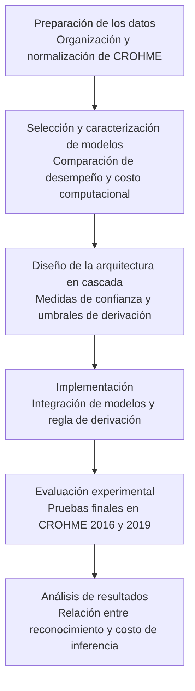

# Metodología

> Transcripción en Markdown de la sección «Metodología» del reporte técnico. Se preservan el contenido académico, las ecuaciones, las claves bibliográficas y los identificadores de referencia. Las rutas de las figuras apuntan a los archivos originales del proyecto; no se incluyen los archivos de imagen/PDF en este documento.

## Índice

- [Preparación de los datos](#preparación-de-los-datos)
- [Selección y caracterización de los modelos preentrenados](#selección-y-caracterización-de-los-modelos-preentrenados)
- [Diseño de la arquitectura en cascada](#diseño-de-la-arquitectura-en-cascada)
- [Implementación de la arquitectura en cascada](#sec-implementacion-cascada)
- [Diseño y procedimiento de evaluación](#diseño-y-procedimiento-de-evaluación)
- [Análisis de resultados](#sec-analisis-resultados)

---


Este capítulo describe la metodología propuesta para el desarrollo y evaluación de la arquitectura de inferencia en cascada, mediante un enfoque cuantitativo y experimental organizado en seis etapas. Estas comprenden la preparación de los datos, la selección y caracterización de los modelos preentrenados, el diseño de la arquitectura y del mecanismo de derivación basado en medidas de confianza global, su implementación, la evaluación experimental y el análisis de resultados.

El procedimiento permitirá comparar el desempeño de reconocimiento y el costo computacional de la arquitectura en cascada respecto a los modelos individuales, así como analizar el comportamiento de las medidas de confianza utilizadas. La organización de las etapas se presenta en la Figura [Etapas de la metodología](#fig-metodologia).


<a id="fig-metodologia"></a>



**Figura (`fig:metodologia`).** Etapas de la metodología propuesta para el desarrollo y evaluación de la arquitectura de inferencia en cascada.

<details>
<summary>Código TikZ original de la figura (para consulta de Codex)</summary>

```latex
\begin{tikzpicture}[
    font=\small,
    etapa/.style args={#1}{
        draw=#1!75!black,
        fill=#1!8,
        rounded corners=4pt,
        line width=0.8pt,
        text width=6.1cm,
        minimum height=1.5cm,
        align=left,
        inner sep=7pt
    },
    flujo/.style={
        -{Latex[length=2.5mm]},
        thick,
        draw=gray!75!black
    }
]

% Primera columna
\node[etapa=blue] (e1) at (0,0) {
    \textbf{ Preparación de los datos}\\[3pt]
    \footnotesize
    Organización y normalización de CROHME.
};

\node[etapa=teal, below=0.5cm of e1] (e2) {
    \textbf{ Selección y caracterización de modelos}\\[3pt]
    \footnotesize
    Comparación de desempeño y costo computacional.
};

\node[etapa=cyan, below=0.5cm of e2] (e3) {
    \textbf{ Diseño de la arquitectura en cascada}\\[3pt]
    \footnotesize
    Medidas de confianza y umbrales de derivación.
};

% Segunda columna
\node[etapa=violet, right=0.85cm of e1] (e4) {
    \textbf{ Implementación}\\[3pt]
    \footnotesize
    Integración de modelos y regla de derivación.
};

\node[etapa=orange, below=0.5cm of e4] (e5) {
    \textbf{ Evaluación experimental}\\[3pt]
    \footnotesize
    Pruebas finales en CROHME 2016 y 2019.
};

\node[etapa=green, below=0.5cm of e5] (e6) {
    \textbf{ Análisis de resultados}\\[3pt]
    \footnotesize
    Relación entre reconocimiento y costo de inferencia.
};

% Conexiones
\draw[flujo] (e1.south) -- (e2.north);
\draw[flujo] (e2.south) -- (e3.north);

\draw[flujo]
    (e3.east) -- ++(0.42,0)
    |- (e4.west);

\draw[flujo] (e4.south) -- (e5.north);
\draw[flujo] (e5.south) -- (e6.north);

\end{tikzpicture}
```

</details>


## Preparación de los datos


### Organización y distribución de CROHME


Para el desarrollo experimental se utilizará el conjunto de datos *Competition on Recognition of Online Handwritten Mathematical Expressions* (CROHME), ampliamente empleado en la evaluación de sistemas de HMER. Se trabajará con imágenes de expresiones matemáticas manuscritas y sus correspondientes representaciones de referencia en formato LaTeX, organizadas como secuencias de *tokens* separados por espacios.

Como referencia, la distribución utilizada por CoMER [@zhao2022comer] comprende 8 836 expresiones de entrenamiento, 986 de CROHME 2014, 1 147 de CROHME 2016 y 1 199 de CROHME 2019. Esta distribución se presenta con fines ilustrativos, junto con ejemplos de imágenes y sus representaciones en LaTeX, como se muestra en la Figura [Ejemplos de CROHME](#fig-ejemplos-crohme).

Dado que se utilizarán modelos preentrenados, el conjunto de entrenamiento no se empleará para modificar sus parámetros. CROHME 2014 se destinará al análisis de las estrategias de combinación de confianza, la obtención de los parámetros de normalización y la definición de los umbrales de derivación para cada medida. Por su parte, CROHME 2016 y CROHME 2019 se reservarán para la evaluación final de las medidas de confianza y su efecto sobre el desempeño de reconocimiento y el costo computacional de la cascada.

<a id="fig-ejemplos-crohme"></a>


**Figura (`fig:ejemplos_crohme`).** Ejemplos de expresiones matemáticas manuscritas del conjunto CROHME y sus correspondientes representaciones de referencia en formato LaTeX.


<a id="sec-compatibilizacion-datos"></a>

### Compatibilización y normalización de los datos


Se revisarán las distribuciones de CROHME utilizadas por los modelos seleccionados, verificando la correspondencia entre identificadores, imágenes y expresiones de referencia. A partir de esta revisión, se establecerán conjuntos comunes de desarrollo y evaluación que permitan comparar los modelos bajo las mismas muestras y criterios de reconocimiento.

Cuando existan diferencias en la representación de las secuencias LaTeX, se aplicará una normalización conservadora a las referencias y predicciones, únicamente con fines de comparación, sin alterar el contenido matemático ni las relaciones estructurales. Se documentarán las diferencias identificadas, las reglas de normalización, los posibles criterios de exclusión y la cantidad final de expresiones utilizadas en cada conjunto.


## Selección y caracterización de los modelos preentrenados


<a id="sec-criterios-seleccion"></a>

### Criterios y procedimiento de selección


La selección de los modelos preentrenados se basará en la revisión comparativa presentada en la Sección `sec:comparacion_modelos_hmer`, considerando sus enfoques de reconocimiento, desempeño reportado y eficiencia computacional. Se buscarán dos modelos con perfiles complementarios: uno de menor costo de inferencia y otro con mayor capacidad de reconocimiento.

Se verificará la disponibilidad de implementaciones y pesos preentrenados, dado que no se contempla el entrenamiento ni el ajuste de los modelos. Para el modelo ligero, también se comprobará la posibilidad de recuperar las probabilidades asociadas con sus decisiones de predicción, necesarias para estimar la confianza global. Los indicadores de eficiencia publicados se tomarán únicamente como referencia, debido a las diferencias entre los entornos experimentales.

Con base en estos criterios, se considerarán preliminarmente SAN como modelo ligero, por sus características de eficiencia, y PosFormer como modelo de mayor capacidad, por su desempeño de reconocimiento reportado. La asignación definitiva dependerá de la caracterización experimental descrita en la Sección [Caracterización experimental de los modelos seleccionados](#sec-caracterizacion-modelos).


<a id="sec-caracterizacion-modelos"></a>

### Caracterización experimental de los modelos seleccionados


Los modelos candidatos serán caracterizados bajo condiciones experimentales comunes, utilizando sus implementaciones y pesos preentrenados, sin modificar sus pará- metros ni los procedimientos de preprocesamiento y decodificación requeridos por cada arquitectura.

El desempeño de reconocimiento se evaluará sobre las mismas expresiones del conjunto CROHME 2014, siguiendo el procedimiento de compatibilización descrito en la Sección [Compatibilización y normalización de los datos](#sec-compatibilizacion-datos). Se calcularán las métricas ExpRate, $\leq 1$ y $\leq 2$ para comparar los resultados de ambos modelos mediante criterios uniformes.

El costo computacional se caracterizará mediante el tiempo de inferencia y el consumo de memoria, utilizando el mismo hardware y condiciones de ejecución controladas. Se registrará la configuración experimental y se analizarán los tiempos mediante el promedio, la mediana y el percentil 95.

Los resultados de la caracterización permitirán verificar la adecuación de los modelos a las etapas propuestas de la cascada, considerando sus diferencias de reconocimiento y costo computacional. En caso de identificar limitaciones relevantes, se podrán considerar otros modelos candidatos siguiendo los mismos criterios de selección y caracterización.


## Diseño de la arquitectura en cascada


<a id="sec-estructura-cascada"></a>

### Estructura y funcionamiento de la cascada


Se diseñará una arquitectura en cascada de dos etapas [@lebovitz2023efficient], integrada por los modelos preentrenados seleccionados conforme a la Sección [Criterios y procedimiento de selección](#sec-criterios-seleccion). Se considerarán preliminarmente SAN como modelo ligero y PosFormer como modelo de mayor capacidad [@yuan2022san; @guan2024posformer], sujetos a los resultados de su caracterización experimental.

Para cada imagen de entrada $x$, el modelo ligero generará una predicción en formato LaTeX y se recuperarán las probabilidades asociadas con sus decisiones de decodificación. A partir de estas, se calculará una puntuación de confianza global $s_k(x)$ para cada medida $k$, que será comparada con distintos umbrales de derivación. Cuando la puntuación satisfaga el criterio de aceptación, se conservará la predicción inicial; en caso contrario, la imagen se derivará al modelo de mayor capacidad.

En las expresiones derivadas, el segundo modelo procesará la imagen original de manera independiente y su predicción sustituirá a la del modelo ligero, sin combinar ambas salidas. El funcionamiento de la arquitectura se presenta en la Figura [Arquitectura en cascada](#fig-arquitectura-cascada).


<a id="fig-arquitectura-cascada"></a>

[Archivo de figura: `Figuras/arquitectura_cascada.pdf`](Figuras/arquitectura_cascada.pdf)

**Figura (`fig:arquitectura_cascada`).** Arquitectura de inferencia en cascada de dos etapas basada en confianza global de secuencia para el reconocimiento de expresiones matemáticas manuscritas.


<a id="sec-obtencion-confianza"></a>

### Obtención de las medidas de confianza global


Para estimar la confianza de las predicciones de SAN, se recuperarán las probabilidades asociadas con las decisiones de símbolos y relaciones estructurales durante la decodificación [@yuan2022san]. Estas se organizarán en los conjuntos $Q_{\mathrm{sim}}(x)=\{q_i^{\mathrm{sim}}\}_{i=1}^{m_s}$ y $P_{\mathrm{rel}}(x)=\{p_j\}_{j=1}^{m_e}$, donde $m_s$ representa la cantidad de decisiones de símbolos consideradas y $m_e$ el número de decisiones estructurales evaluadas. Se excluirán los elementos de relleno ajenos al proceso de predicción y no se utilizarán las expresiones de referencia para obtener las probabilidades.

Para las relaciones estructurales se considerarán dos alternativas: utilizar únicamente las probabilidades de las relaciones aceptadas por SAN o incluir todas las decisiones estructurales evaluadas. En la primera se conservarán los valores $p_j>0.5$, mientras que en la segunda se utilizará $p_j$ para las relaciones aceptadas y $1-p_j$ para las descartadas, considerando el umbral de decisión del modelo [@yuan2022san]. Esta última alternativa se establecerá como principal, al incorporar la información probabilística de las decisiones de presencia y ausencia de relaciones.

Sobre las probabilidades de símbolos y relaciones se calcularán por separado las medidas Chow-Sum, Chow-Average y Chow-Quantile-0 [@gupta2024cascades], definidas en la Sección `sec:medidas_confianza`. Debido a que las puntuaciones de ambas fuentes pueden presentar diferentes escalas y depender de cantidades distintas de decisiones, se considerarán dos estrategias de combinación: la suma directa y la combinación mediante normalización Min-Max.

La suma directa se calculará como $s_k^{\mathrm{dir}}(x)=s_k^{\mathrm{sim}}(x)+s_k^{\mathrm{rel}}(x)$. Para la segunda estrategia, las puntuaciones se normalizarán de manera independiente por fuente y medida, con el propósito de reducir sus diferencias de escala:

<a id="eq-normalizacion-confianza"></a>

$$
    \widetilde{s}_k^g(x) =
    \frac{s_k^g(x)-a_k^g}{b_k^g-a_k^g},
    \qquad
    g\in\{\mathrm{sim},\mathrm{rel}\}
$$


Donde $s_k^g(x)$ representa la puntuación obtenida mediante la medida $k$ para la fuente $g$, mientras que $a_k^g$ y $b_k^g$ corresponden a sus valores mínimo y máximo, respectivamente, calculados sobre CROHME 2014. Estos parámetros permanecerán fijos durante la evaluación final, permitiendo valores normalizados fuera del intervalo $[0,1]$ cuando se excedan los límites del conjunto de desarrollo. Si $a_k^g=b_k^g$, se asignará un valor normalizado constante de $0.5$ para evitar la división entre cero.

Posteriormente, las puntuaciones normalizadas se combinarán mediante un promedio con pesos iguales:

<a id="eq-confianza-combinada"></a>

$$
    s_k(x) =
    \frac{
        \widetilde{s}_k^{\mathrm{sim}}(x)
        + \widetilde{s}_k^{\mathrm{rel}}(x)
    }{2},
    \qquad
    k\in\{\mathrm{sum},\mathrm{avg},\mathrm{min}\}
$$


Cuando no existan decisiones estructurales incluidas en una alternativa, se utilizará únicamente la puntuación de símbolos, normalizada o sin normalizar según la estrategia de combinación correspondiente. Los parámetros Min-Max de relaciones se calcularán utilizando únicamente las expresiones para las que exista una puntuación estructural definida.

Como estrategia principal, se considerarán todas las decisiones de presencia y ausencia de relaciones estructurales realizadas por SAN. Las puntuaciones obtenidas para símbolos y relaciones mediante cada medida de confianza se normalizarán por separado utilizando Min-Max y posteriormente se combinarán mediante un promedio con pesos iguales. En CROHME 2014 se analizará la influencia de estas decisiones mediante dos comparaciones: la primera utilizará únicamente las relaciones estructurales aceptadas, manteniendo la combinación normalizada; la segunda conservará todas las decisiones estructurales, pero empleará la suma directa de las puntuaciones sin normalización. Se examinarán las distribuciones de confianza y el desempeño de reconocimiento a distintas tasas de derivación, sin buscar una combinación óptima. La estrategia principal permanecerá fija durante la evaluación final de las tres medidas de confianza.


<a id="sec-seleccion-umbrales"></a>

### Definición de umbrales de derivación


Los umbrales de derivación se establecerán a partir de las puntuaciones de confianza global obtenidas en CROHME 2014 mediante la combinación normalizada descrita en la Sección [Obtención de las medidas de confianza global](#sec-obtencion-confianza). Para cada una de las medidas Chow-Sum, Chow-Average y Chow-Quantile-0, se considerarán 99 umbrales candidatos, correspondientes a los percentiles del 1 al 99 de su distribución de puntuaciones, con incrementos de un punto porcentual, siguiendo el enfoque basado en percentiles utilizado por Wang et al. [@wang2022wisdom]. Se incluirán además los casos extremos de aceptación y derivación de todas las expresiones.

Los umbrales definidos para cada medida se mantendrán fijos durante la evaluación sobre CROHME 2016 y CROHME 2019, sin realizar ajustes a partir de estos conjuntos. En lugar de seleccionar una única configuración, se comparará el comportamiento de las tres medidas mediante el ExpRate, el tiempo promedio de inferencia y la tasa de escalamiento obtenidos para los distintos umbrales, con el propósito de analizar el compromiso entre reconocimiento y costo computacional de la arquitectura.


<a id="sec-implementacion-cascada"></a>

## Implementación de la arquitectura en cascada


La arquitectura en cascada se implementará en Python utilizando PyTorch, mediante la integración de los modelos preentrenados y el mecanismo de derivación descrito en la Sección [Estructura y funcionamiento de la cascada](#sec-estructura-cascada). Los modelos conservarán sus parámetros sin modificaciones y se incorporarán las tres medidas de confianza global con los umbrales definidos en la Sección [Definición de umbrales de derivación](#sec-seleccion-umbrales), permitiendo evaluar distintas configuraciones de derivación.

Para cada expresión se almacenarán su identificador, las predicciones de ambos modelos, las probabilidades recuperadas de SAN y los tiempos individuales de inferencia. Estos registros permitirán reconstruir las decisiones de derivación y calcular el desempeño de reconocimiento y el tiempo estimado de las distintas configuraciones, sin ejecutar nuevamente los modelos para cada umbral. Este procedimiento se aplicará tanto en CROHME 2014 como en los conjuntos de evaluación final.

Adicionalmente, se ejecutará la arquitectura completa para un conjunto reducido de configuraciones representativas, definidas previamente mediante los percentiles 25, 50 y 75 de cada medida, además de los casos extremos de aceptación y derivación total. Estas ejecuciones permitirán medir directamente el tiempo de inferencia y el consumo de memoria bajo condiciones experimentales controladas, distinguiendo los tiempos medidos de las estimaciones obtenidas a partir de los registros individuales.


## Diseño y procedimiento de evaluación


<a id="sec-configuracion-evaluacion"></a>

### Configuración experimental y métricas de evaluación


La evaluación final de la arquitectura en cascada se realizará sobre CROHME 2016 y CROHME 2019, utilizando las tres medidas de confianza global con la estrategia de combinación establecida en la Sección [Obtención de las medidas de confianza global](#sec-obtencion-confianza). Para cada medida se emplearán los umbrales definidos a partir de CROHME 2014, conforme a la Sección [Definición de umbrales de derivación](#sec-seleccion-umbrales), sin realizar ajustes mediante los conjuntos de evaluación final.

Los experimentos se realizarán bajo condiciones comunes de *hardware* y *software*, utilizando las mismas expresiones y criterios de comparación establecidos en la Sección [Compatibilización y normalización de los datos](#sec-compatibilizacion-datos). El desempeño de reconocimiento se evaluará mediante ExpRate, $\leq 1$ y $\leq 2$, mientras que el costo computacional se analizará mediante el tiempo de inferencia y el consumo de memoria. Asimismo, se calculará la tasa de derivación de cada configuración.

Para evaluar los distintos umbrales, se utilizarán los registros individuales descritos en la Sección [Implementación de la arquitectura en cascada](#sec-implementacion-cascada). A partir de las decisiones de derivación, se determinará qué predicción de los modelos correspondería a cada expresión, permitiendo calcular las métricas de reconocimiento y estimar el tiempo promedio de inferencia de cada configuración sin ejecutar nuevamente los modelos.

Adicionalmente, se ejecutará la arquitectura completa para las configuraciones representativas establecidas en la Sección [Implementación de la arquitectura en cascada](#sec-implementacion-cascada), con el propósito de medir directamente el tiempo de inferencia y el consumo de memoria. Las mediciones de tiempo considerarán el promedio, la mediana y el percentil 95 por expresión, mediante ejecuciones de calentamiento, sincronización de operaciones de GPU y mediciones repetidas bajo condiciones controladas.

Los resultados se presentarán por separado para CROHME 2016 y CROHME 2019, distinguiendo los tiempos estimados de aquellos medidos directamente. El ExpRate y el tiempo promedio de inferencia se utilizarán como métricas principales para analizar el compromiso entre desempeño de reconocimiento y costo computacional.


<a id="sec-comparacion-referencias"></a>

### Comparación con los modelos individuales y métodos de referencia


La arquitectura en cascada se comparará con la ejecución individual de los modelos ligero y de mayor capacidad, utilizando las mismas expresiones y criterios de evaluación establecidos en la Sección [Configuración experimental y métricas de evaluación](#sec-configuracion-evaluacion).

Adicionalmente, se utilizará una estrategia de derivación aleatoria como método de referencia, en la que las expresiones enviadas al segundo modelo se seleccionarán sin considerar las puntuaciones de confianza. Para cada configuración evaluada, se mantendrá la misma cantidad de derivaciones que en la cascada basada en confianza. La selección se repetirá con distintas semillas para analizar el promedio y la variabilidad de sus resultados.

También se considerará un método de referencia ideal (*oracle*), construido a partir de las predicciones individuales de ambos modelos y las expresiones de referencia. Para cada cantidad de derivaciones, se seleccionarán aquellas que maximicen el número de expresiones reconocidas correctamente, priorizando los casos en los que el modelo ligero falla y el de mayor capacidad acierta.

Si estas expresiones no completan la cantidad de derivaciones establecida, se seleccionarán casos cuya derivación no modifique el reconocimiento exacto y, únicamente cuando sea necesario, aquellos que reduzcan el número de predicciones correctas. Debido a que requiere conocer las respuestas de referencia, el *oracle* se utilizará exclusivamente como límite superior experimental del ExpRate para una cantidad fija de derivaciones, y no como un mecanismo aplicable durante la inferencia real.


<a id="sec-analisis-resultados"></a>

## Análisis de resultados


Se analizará cómo varían el desempeño de reconocimiento y el tiempo promedio de inferencia conforme cambia la tasa de derivación, identificando las diferencias entre las medidas de confianza global y las configuraciones evaluadas. Asimismo, se examinará si los compromisos observados entre reconocimiento y costo computacional presentan un comportamiento consistente en CROHME 2016 y CROHME 2019, así como las diferencias entre los tiempos estimados y las mediciones directas de la cascada.

Se analizarán las diferencias de desempeño respecto a los modelos individuales y los métodos de referencia, considerando si las decisiones basadas en confianza ofrecen ventajas frente al enrutamiento aleatorio y qué tan próximas se encuentran al reconocimiento alcanzable mediante el *oracle* para una misma cantidad de derivaciones. A partir de estos resultados, se identificarán las condiciones en las que las medidas de confianza permiten establecer decisiones de derivación favorables, así como las limitaciones observadas en la arquitectura propuesta.
