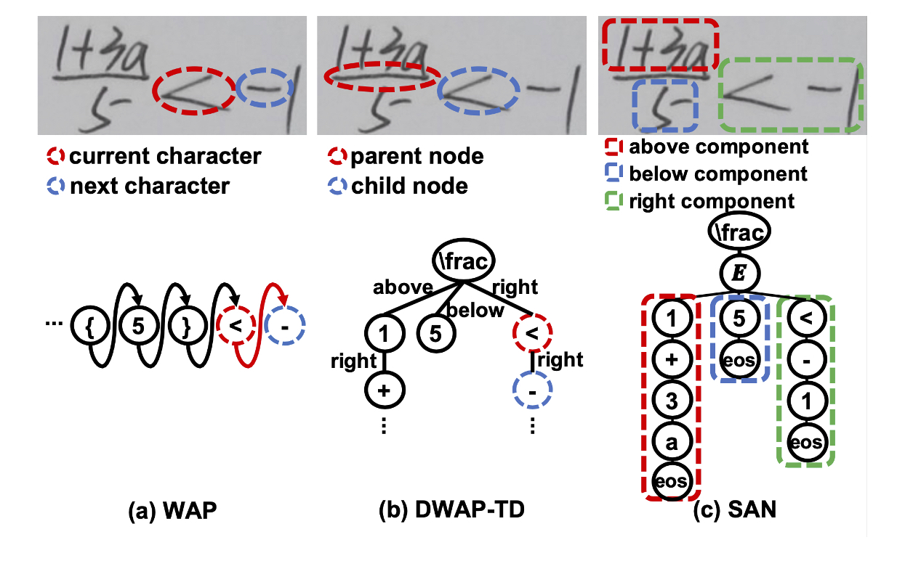

# Syntax-Aware Network for Handwritten Mathematical Expression Recognition

This is the official pytorch implementation of [SAN](https://arxiv.org/abs/2203.01601) (CVPR'2022).



### Environment

```
python==3.8.5
numpy==1.22.2
opencv-python==4.5.5.62
PyYAML==6.0
tensorboardX==2.5
torch==1.6.0+cu101
torchvision==0.7.0+cu101
tqdm==4.64.0
```

### Train

```
python train.py --config path_to_config_yaml
```

### Inference
```
python inference.py --config path_to_config_yaml --image_path path_to_image_folder --label_path path_to_label_folder
```

```
Example:
python inference.py --config 14.yaml --image_path data/14_test_images --label_path data/test_caption.txt
```

SANv2 also writes the probability distribution for every decoding step. The
default output file is `token_probabilities.json`; a different path can be
selected with `--probabilities_path`:

```
python inference.py --config 14.yaml --image_path data/14_test_images --label_path data/test_caption.txt --probabilities_path my_probabilities.json
```

Each step includes the selected token, its probability, the complete token
distribution and, when the `struct` token is selected, the probabilities of
the structural relations.

### Dataset

CROHME: 
```
Download the dataset from: https://github.com/JianshuZhang/WAP/tree/master/data
```

HME100K
```
Download the dataset from the official website: https://ai.100tal.com/dataset
```

### Citation

If you find this dataset helpful for your research, please cite the following paper:

```
@inproceedings{yuan2022syntax,
  title={Syntax-Aware Network for Handwritten Mathematical Expression Recognition},
  author={Yuan, Ye and Liu, Xiao and Dikubab, Wondimu and Liu, Hui and Ji, Zhilong and Wu, Zhongqin and Bai, Xiang},
  booktitle={Proceedings of the IEEE/CVF Conference on Computer Vision and Pattern Recognition},
  pages={4553--4562},
  year={2022}
}
```
